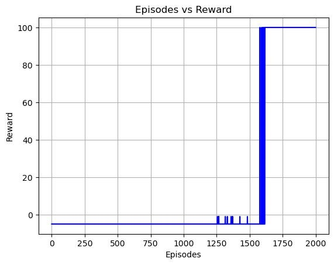
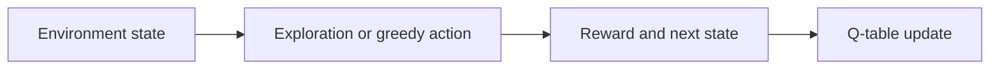

# Reinforcement Learning Exercises

### MountainCar Q-learning and a Double Q-learning grid-world notebook.

**Python · NumPy · Tabular Q-learning · Tkinter**

*Archived coursework / research prototype · Not actively maintained*

An archived coursework collection exploring value-based reinforcement learning in two settings: a MountainCar script and a GUI-based Double Q-learning environment.

*Historical Double Q-learning episode/reward plot.*

## What is included

- MountainCar action-value learning script
- Double Q-learning agent and Tkinter environment
- Historical episode, reward, and value plots

The repository includes 2 directly browsable source/notebook files and a [source archive](source.zip) containing 2 files with their package structure preserved. See [SOURCE_INDEX.md](SOURCE_INDEX.md) for its contents. Reference components retain their labels and upstream notices.

## Workflow

*Diagram reconstructed from the recovered source or project description.*

## Preserved results and examples

*Historical episode/step plot.*

*Historical value plot from the same notebook.*

These are historical artifacts, not fresh executions. Where a report includes scores or rankings, their original evaluation protocol has not been independently reproduced.

## Explore / run

Open `double-q-learning.ipynb` in a Python environment with a desktop display for Tkinter. Inspect `mountain_car_q.py` for the Gym API and dependency versions it expects. Adapt legacy APIs before running with current packages.

### Direct source files

- [double-q-learning.ipynb](double-q-learning.ipynb)
- [mountain_car_q.py](mountain_car_q.py)

## Project status

The plots are original saved notebook outputs. They are not new evaluations and do not establish performance across seeds or environments.

No training, benchmark, paid API request, or external service deployment was performed to prepare this showcase. Team names, student IDs, raw personal documents, and embedded credentials are excluded from the public upload copies. Additional scope notes are in [SOURCE_NOTES.md](SOURCE_NOTES.md).
